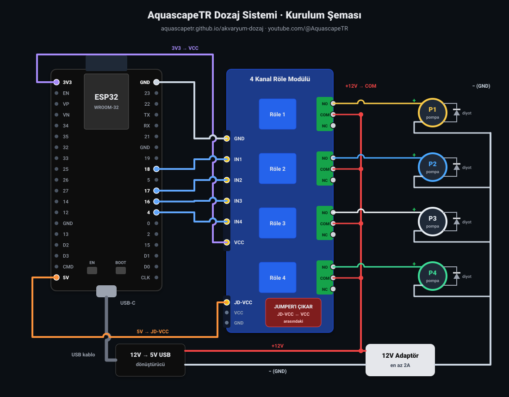

# Akvaryum Otomatik Gübre Dozaj Sistemi

**AquascapeTR** · [YouTube](https://www.youtube.com/@AquascapeTR)

4 kanallı, ml bazlı, zamanlamalı akvaryum gübre dozaj sistemi. Bir ESP32 geliştirme kartı, hazır bir 4 kanal röle modülü ve 12V peristaltik pompalarla, lehimsiz yapılır. **Home Assistant veya başka bir sunucu gerekmez**; kontrol, kartın kendi web sayfasından yapılır.

## 👉 Kurulum sayfası

**https://aquascapetr.github.io/akvaryum-dozaj/**

ESP32'yi USB ile bilgisayara takıp oradaki **"Yazılımı Yükle"** butonuna basmanız yeterli (Chrome/Edge). Program kurmanıza, kod yazmanıza gerek yok. ESP32 ve ESP32-S3 kartları otomatik tanınır.

## Özellikler

- 4 bağımsız pompa, doz miktarı **ml** cinsinden
- Her pompa için ayrı doz saati, otomatik açma/kapama
- 30 saniyelik test ile kolay kalibrasyon
- Şişede kalan gübre takibi (her dozda otomatik düşer)
- Wi-Fi kurulumu telefondan, kurulum ağı üzerinden
- Ayarlar kartın hafızasında; elektrik kesilince kaybolmaz
- Yazılım güncellemesi kablosuz (web sayfasından)

### Güvenlik
- Pompalar asla aynı anda çalışmaz; sırayla ve 10 sn arayla
- Tek doz en fazla “Maks. Pompa Süresi” kadar sürer (varsayılan 30 sn)
- Her “kapat” komutu 3 kez gönderilir, boştayken 15 sn'de bir tüm röleler kapatılır
- Açılışta tüm röleler kapatılır, **Acil Durdur** butonu

## Malzeme listesi

| Parça | Not |
|---|---|
| ESP32 geliştirme kartı (USB'li, CP2102 veya CH340) | ESP32-S3 de olur |
| 4 kanal 5V röle modülü (optokuplörlü, JD-VCC jumper'lı) | |
| 12V → 5V USB dönüştürücü (en az 2A) | ESP32'yi 12V adaptörden besler |
| 4 × 12V DC peristaltik pompa | Örn. Kamoer |
| 12V adaptör, en az 2A | |
| 4 × diyot (1N4007 veya 1N5819) | Pompa başına bir tane |
| Jumper kablolar, silikon hortum, gübre şişeleri | Lehim gerekmez |

## Bağlantı şeması

| ESP32 | Röle modülü |
|---|---|
| 3V3 | VCC |
| 5V | JD-VCC (**jumper çıkarılır**) |
| GND | GND |
| GPIO18 | IN1 (Pompa 1) |
| GPIO17 | IN2 (Pompa 2) |
| GPIO16 | IN3 (Pompa 3) |
| GPIO4 | IN4 (Pompa 4) |

- 12V (+) → her rölenin `COM` ucu; rölenin `NO` ucu → pompanın (+) ucu; pompanın (−) ucu → 12V (−)
- Diyot pompanın uçlarına: **çizgili uç (+) tarafa**
- ESP32'yi 12V→5V USB dönüştürücüyle besleyin

## Kısa kurulum

1. ESP32'yi USB ile bilgisayara tak, [kurulum sayfasından](https://aquascapetr.github.io/akvaryum-dozaj/) yazılımı yükle.
2. Bağlantıları şemaya göre yap.
3. Telefonla **Dozaj Kurulum** ağına bağlan (şifre `dozaj1234`), ev Wi-Fi'ını seç.
4. **http://akvaryum-dozaj.local** adresinden kalibrasyon ve doz ayarlarını yap.

> Kontrol paneli şifresizdir; yalnızca ev ağınızdan erişilebilir.

## Notlar

- Kart saati internetten alır. Elektrik kesintisinden sonra internet yoksa o süre içindeki dozlar **atlanır** (fazla doz riski yoktur).
- Kendi ihtiyacınıza göre değiştirmek için yapılandırma dosyası: [`firmware/akvaryum-dozaj.yaml`](firmware/akvaryum-dozaj.yaml) (ESPHome)
